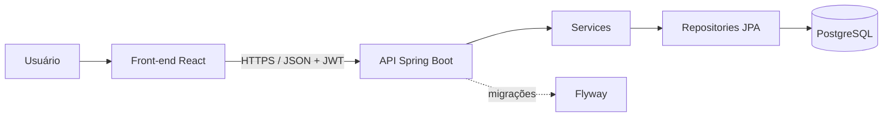
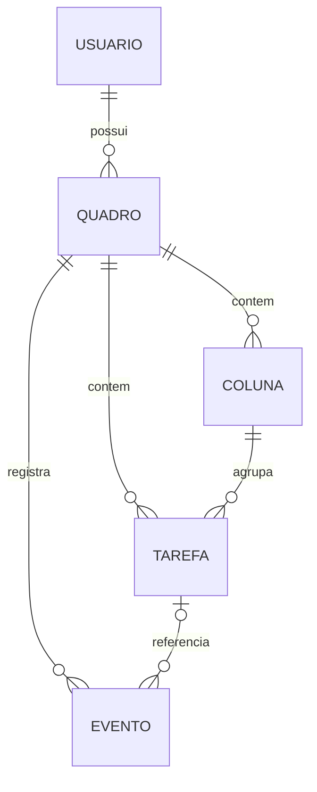

# Arquitetura

Kanban pessoal de tarefas com visual inspirado em laboratório forense. O domínio é o de tarefas comuns; o tema é apenas estético.

## Visão geral



- **Front-end**: React + Vite + TypeScript, dnd-kit (arrastar e soltar), TanStack Query (cache e atualização otimista).
- **API**: Spring Boot (Java 21), camadas controller → service → repository, DTOs na borda.
- **Banco**: PostgreSQL, esquema versionado com Flyway.
- **Autenticação**: JWT, senhas com BCrypt.

## Modelo de dados

| Tabela    | Campos principais                                                                                   | Observações                         |
|-----------|-----------------------------------------------------------------------------------------------------|-------------------------------------|
| `usuario` | id, email (único), senha_hash, nome, criado_em                                                      | Senha com BCrypt                    |
| `quadro`  | id, usuario_id, titulo, criado_em                                                                   | Isolamento por usuário              |
| `coluna`  | id, quadro_id, nome, posicao                                                                        | A fazer, Em andamento, Concluído    |
| `tarefa`  | id, quadro_id, coluna_id, titulo, descricao, posicao (numeric), versao, criado_em, atualizado_em    | `versao` para concorrência otimista |
| `evento`  | id, quadro_id, usuario_id, tarefa_id (nullable), tipo, dados (jsonb), criado_em                     | Histórico de atividades             |



## Endpoints

| Método | Rota                               | Descrição                                  |
|--------|------------------------------------|--------------------------------------------|
| POST   | `/api/auth/registro`               | Cria usuário                               |
| POST   | `/api/auth/login`                  | Retorna JWT                                |
| GET    | `/api/quadros`                     | Lista quadros do usuário                   |
| POST   | `/api/quadros`                     | Cria quadro                                |
| GET    | `/api/quadros/{id}`                | Quadro com colunas e tarefas               |
| PUT    | `/api/quadros/{id}`                | Atualiza quadro                            |
| DELETE | `/api/quadros/{id}`                | Remove quadro                              |
| POST   | `/api/quadros/{id}/colunas`        | Cria coluna                                |
| POST   | `/api/quadros/{id}/tarefas`        | Cria tarefa                                |
| PATCH  | `/api/tarefas/{id}`                | Edita tarefa                               |
| POST   | `/api/tarefas/{id}/mover`          | Move tarefa (coluna destino + vizinhos)    |
| GET    | `/api/quadros/{id}/historico`      | Histórico paginado por cursor              |
| GET    | `/api/quadros/{id}/exportar.csv`   | Exporta tarefas em CSV                     |

## Fluxo: mover uma tarefa

1. O front aplica a mudança na tela imediatamente (atualização otimista).
2. A API abre uma transação e bloqueia a tarefa com `SELECT ... FOR UPDATE`.
3. Calcula a nova posição, atualiza a tarefa, incrementa `versao` e insere um `evento`.
4. Confirma a transação e devolve a tarefa atualizada.
5. Em caso de erro ou conflito (409), o front restaura o estado anterior.

## Estrutura de pastas

```
kanban-tarefas-forense/
├── backend/
│   └── src/
│       ├── main/
│       │   ├── java/com/danielnaf/laboratorio/
│       │   │   ├── auth/          login, registro, JWT
│       │   │   ├── quadro/        quadros e colunas
│       │   │   ├── tarefa/        tarefas e regra de posição
│       │   │   ├── historico/     eventos (histórico de atividades)
│       │   │   ├── exportacao/    exportação CSV
│       │   │   ├── usuario/       entidade e repositório de usuário
│       │   │   ├── seguranca/     configuração do Spring Security
│       │   │   └── erro/          tratamento global de exceções
│       │   └── resources/db/migration/   migrações Flyway
│       └── test/java/com/danielnaf/laboratorio/
├── frontend/
│   └── src/
│       ├── api/           cliente HTTP (único ponto que conhece as URLs)
│       ├── features/      auth, quadro, historico, exportacao
│       ├── temas/         tema forense (padrão) e alternativo
│       ├── componentes/   componentes genéricos
│       └── tipos/         tipos TypeScript da API
├── docs/
│   ├── arquitetura.md
│   └── adr/
└── docker-compose.yml
```

O código é organizado **por feature**, não por camada: tudo que pertence a tarefas fica em `tarefa/`.

## Testes

- Unitários: regra de posição (`PosicaoService`) e escrita de CSV.
- Integração: JUnit 5 + MockMvc + Testcontainers com PostgreSQL real.

## Cronograma

| Semana | Entrega                                                        |
|--------|----------------------------------------------------------------|
| 1      | Modelagem, migrações e CRUD de quadros e tarefas               |
| 2      | Mover tarefas com regra de posição e transação                 |
| 3      | Autenticação JWT e isolamento por usuário                      |
| 4      | Histórico de atividades e exportação CSV                       |
| 5      | Front-end do quadro com arrastar e soltar                      |
| 6      | Tema forense, testes de integração e deploy                    |
| 7–8    | Extras (tempo real, estatísticas, tema alternativo)            |

## Decisões

Ver [`docs/adr`](adr/).
